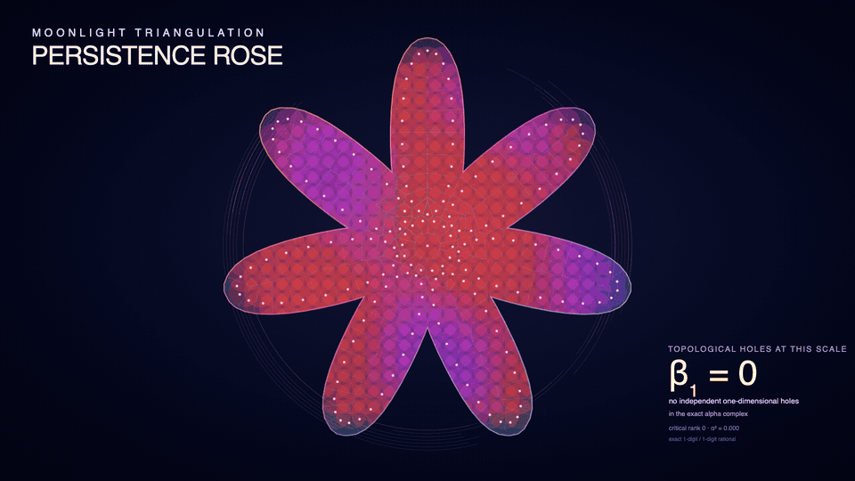

# moonlight-planar

> Part of **Moonlight**, the sheaf-theoretic computation layer beneath
> [Melusine](https://bluerose.blue) and Pale Meridian.

`moonlight-planar` carries native hexagonal regions plus Delaunay and
constrained Delaunay triangulations as lawful finite-set algebras. A hex region
is an immutable packed cell selection; a mesh is observed through its canonical
site set. In both domains operations close over the same kind of value: a
mesh represents its site set, a join returns a valid Delaunay representative,
and the result is a triangulation again — so the operations close, compose, and
fold. Operations return typed obstructions where the finite arena cannot
represent a result.

Delaunay triangulation, constrained Delaunay (CDT), exact rational planar
regions and labelled overlay, intrinsic valuations, polygonal Minkowski
morphology, exact regular/power geometry, the Voronoi dual, natural-neighbour interpolation, Ruppert
refinement, walk point location, convex hull, exact Shewchuk predicates,
exact zigzag persistence across non-nested activation depths, and versioned
binary serialization.

## Persistence rose



[Open the animation directly.](./docs/persistence-rose/moonlight-triangulation-persistence-rose.gif)
· [Open the static vector poster.](./docs/persistence-rose/moonlight-triangulation-persistence-rose.svg)
· [Read the exhibit guide.](./docs/persistence-rose/README.md)

## Operations

| Operation | Use when | Inputs | Result |
| --- | --- | --- | --- |
| `curveStep` / `openTrail` / `closeWith` / `locate` | Curves must retain editable controls rather than sampled points | Relative line, quadratic, cubic, or positive-weight rational-conic steps and an anchor | Exact open/closed trail with structural endpoint continuity |
| `lowerOpenTrail` / `lowerClosedTrail` / `lowerSimpleRegion` | Authored curves need bounded polygonal observations | Explicit error metric and subdivision budgets, plus curves / outer-hole components | Source-local samples and error receipts / admitted polygonal region, or typed refusal |
| `fill` / `stroke` / `renderSvg` | Curves need ordered illustration and publication | Canonical curves, typed paint, and fixed SVG options | Pure `Picture part` / SVG document, or `SvgError` |
| `motif` / `attachMotif` / `transformMotif` | Reusable parts must retain semantic attachments | Picture, total typed port frames, destination frame | Picture and ports transformed coherently |
| `geometryEnvelope` / `alignMotif` / `arrangeMotifs` | Parts need conservative geometric layout | Canonical picture / motifs, axis, fraction or signed gap | Exact control support / coherently moved motifs; not ink bounds |
| `hexLayout` / `hexNeighbourCoord` | A bounded native hexagonal world needs dense identity and arithmetic adjacency | Axial origin and extents / coordinate and direction | `HexLayout` / optional neighbour / typed layout obstruction |
| `hexRegionFromCoords` / `hexRegionFromPackedWords` / `hexRegionGenerateM` | Sparse, packed, or effectful dense authoring | Coordinates, canonical words, or a coordinate predicate plus layout | Opaque canonical `HexRegion` / caller or representation obstruction |
| `hexRegionUnion` / `hexRegionIntersection` / `hexRegionDifference` / `hexRegionSymmetricDifference` | Native cell selections must combine without triangulation or polygon construction | Two same-layout `HexRegion`s | Packed `HexRegion` / layout mismatch |
| `hexRegionDilate` / `hexRegionErode` / `hexRegionOpening` / `hexRegionClosing` | A bounded hex selection needs lawful neighbourhood morphology | `HexRegion` | Packed `HexRegion`; clipped dilation and its right-adjoint erosion |
| `hexRegionComponentLabels` / `hexRegionDistancesWithin` | Gameplay and analysis need connected sections and shortest hex steps without boxed graphs | Selected domain and sources | Opaque layout-indexed labels or distance map / typed source obstruction |
| `restrictHexRegion` / `reframeHexRegion` | A local section changes context | Target layout and region | Packed restricted/reframed region / typed restriction obstruction |
| `glueCompatibleHexRegions` | Local sections must descend only after agreeing on overlaps | Nonempty local-region family | Glued `HexRegion` / exact overlap witness |
| `hexRegionPlanarRegion` | Native selected cells need exact polygonal operations | `HexRegion` | Existing `PlanarRegion` / typed boundary or publication obstruction |
| `hexRegionByCenterInPlanarRegion` / `hexRegionFullyCoveredByPlanarRegion` / `hexRegionIntersectingPlanarRegion` | Exact geometry must restrict onto a supplied hex context without ambiguous boundary semantics | `HexLayout` and `PlanarRegion` | Native packed `HexRegion` |
| `delaunayGeometry` | Coordinates own the input | `Vector Point` | Geometry-only mesh / `BuildError` |
| `delaunayFromCoordinates` | Payloads have a separate plane | Defaults, points, payloads, duplicate policy | `BuildResult` / `BuildError` |
| `insert` / `insertAt` / `insertMany` | An immutable mesh gains sites or payload replacements | Mesh plus payloads or explicit points | `InsertionResult` / `BuildResult` / `BuildError` |
| `withSession` | Many inserts and removals should publish once | Mesh, peak added-site count, composed `Session` | Result, mesh, and `BuildStats` / `BuildError` |
| `withScopedTriangulation` | Local traversal must make cross-mesh identifiers unrepresentable | Mesh and rank-2 continuation | Zero-cost scoped mesh and identifiers |
| `removeVertex` / `locateAndRemove` | A resident handle or exact position must be removed | Mesh plus `VertexId` / `Point` | `RemovalResult` / optional result / `BuildError` |
| `siteRelation` | Supports need exact classification | Two meshes | `SiteRelation` |
| `union` / `unions` | Unconstrained supports must join | Two meshes / mesh list | Union mesh / `BuildError` |
| `intersection` / `intersectionWith` | Shared support is required | Two meshes; optional payload combiner | Common-site mesh / `BuildError` |
| `difference` / `symmetricDifference` | Left-only / exclusive support is required | Source and mask / two meshes | Result mesh / `BuildError` |
| `constrainedDelaunay` | Segments author topology | Defaults, positioned vertices, index pairs | `BuildResult` / `CdtError` |
| `addConstraintEdge(s)` / `removeConstraintEdge` | Constraints change on a resident mesh | Mesh plus vertex pair(s) / edge | Constraint receipt or mesh / `CdtError` |
| `unionConstrained` / `unionConstrainedWith` | Arbitrary constrained meshes must join | Two meshes; optional payload combiner | Constrained mesh / `ConstrainedUnionError` |
| `extendConstrainedWith` | One constrained mesh owns identity | Combiner, base, extension | `ConstrainedExtensionResult` / `ConstrainedUnionError` |
| `joinSeparatedConstrained` | Inputs are strictly x-separated | Face predicate, refinement parameters, two meshes | `ConstrainedSeamResult` / `ConstrainedUnionError` |
| `refine` | Quality applies globally | Vertex constructor, parameters, mesh | `RefinementResult` / `BuildError` |
| `refineWithinDomain` | Quality applies to admitted faces | Vertex constructor, parameters, face set, mesh | `RefinementDomainResult` / `BuildError` |
| `faceComponents` | Bounded faces must descend by label | Mesh, `FaceId -> label` | `[(label, FaceComponent)]` |
| `componentBoundary` | One component must publish as loops | Mesh, `FaceComponent` | `RegionBoundary` / `BoundaryObstruction` |
| `locatePoint` / `locatePointWithHint` | An admitted point needs an exact cell classification | Mesh, `QueryPoint`, optional hint | `Location`, optionally with `LocationStats` |
| `lineIntersections` | A segment needs its ordered mesh crossings | Mesh and admitted endpoints | `[Intersection]` |
| `verticesInCircle` / `verticesInRectangle` | A metric window selects resident sites | Mesh and circle / rectangle | Handles / typed metric error |
| `exactClipRetainedPolygon` | A convex exact polygon must meet closed half-planes while retaining source lines | Retained polygon and half-plane list | Empty, point, segment, or polygon section plus receipt / `ExactClipError` |
| `overlayLayers` | Layers need one exact arrangement | Two `PlanarLayer`s | `OverlayResult` / `OverlayError` |
| `overlayAll` | A nonempty layer family needs one fused common refinement | `NonEmpty (PlanarLayer label)` | `OverlayResult (NonEmpty label)` / `OverlayError` |
| `overlayClosedUnion` / `overlayClosedIntersection` / `overlayRegularizedDifference` | Boolean output may retain lower cells | Two label predicates, `OverlayResult` | `ExactCellSet` / `OverlaySelectionError` |
| `overlaySelectedRegion` / `overlayPlanarLayer` | Exact faces must publish as polygons | Label predicate / `OverlayResult labels` | `PlanarRegion` / `PlanarLayer labels`, or `RegionPublicationError` |
| `overlayMass` / `overlayConfusion` | Only exact selected area or finite label masses are needed | Predicate / `OverlayResult labels` | Exact area / mass map, or typed observation obstruction |
| `foldBoundedOverlayCells` | Direct exact moments or another boundary fold is required | Accumulator, labels and oriented exact edge pairs | Accumulator / `OverlayCellWitness` |
| `layerCovers` | A labelled layer must cover an admitted polygonal window | `PlanarLayer`, `PolygonComponent` | `()` or `LayerCoverageError` carrying the exact gap |
| `cellValuations` / `regionValuations` | Intrinsic measures are required | `ExactCellSet` / `PlanarRegion` | `PlanarValuations` / `ValuationError` |
| `minkowskiSum` / `polygonOffset` | Regions must add / expand | Two regions / element and region | Region plus receipt / `MinkowskiError` |
| `erodeBy` / `openWith` / `closeWith` | Regularized morphology is required | Structuring element, region | Region plus receipt / `MinkowskiError` |
| `regularTriangulation` | Weighted sites need unbounded topology and exact dual geometry | Nonempty `PowerSite` family | Opaque regular topology, dispositions, segments/rays/lines, and receipt / `PowerDiagramError` |
| `insertRegularSite` / `removeRegularSite` | A persistent regular value gains or loses one stable-labelled site | `PowerSite` / label and `RegularTriangulation` | New regular value, changed-site support, and exact disposition transitions / `RegularEditError` |
| `reweightRegularSites` | Stable sites receive one optimizer or simulation weight update | `Map label PowerWeight`, `RegularTriangulation` | New regular value, changed-site support, and exact disposition transitions / `RegularEditError` |
| `boundedPowerDiagram` | Labelled weighted sites need exact cells inside one finite convex domain | `ConvexPolygon`, nonempty `PowerSite` family | Total labelled dispositions plus rational-width receipt / `PowerDiagramError` |
| `boundedPowerDiagramFromRegular` | An admitted regular value already owns the weighted-site topology | `ConvexPolygon`, `RegularTriangulation` | Exact bounded cells without rebuilding the lifted hull / `PowerDiagramError` |
| `upperEnvelope` | Exact affine forms need their labelled argmax decomposition in a polygonal window | `PolygonComponent`, `Map label AffineForm` | `PlanarLayer (Maybe label)` / `UpperEnvelopeError` |
| `alphaShapeContainsFace` | One face at one radius is enough | `RadiusSquared`, mesh, `FaceId` | `Bool` |
| `alphaFiltration` | Every critical radius matters | Delaunay mesh | `AlphaFiltration` / `AlphaFiltrationError` |
| `regularAlphaFiltration` | Weighted regular topology needs signed exact births | `RegularTriangulation` | `RegularAlphaFiltration` / `RegularAlphaError` |
| `fromExactCellSet` | Exact cells need a cellular chain view | `ExactCellSet` | `DCELComplex` / `DCELError` |
| `filteredAlphaComplex` | Alpha births must enter persistence | `AlphaFiltration` | Filtered chain complex / `DCELError` |
| `activationAlphaZigzag` | Non-nested labelled depths need checked correspondence | `NonEmpty (ActivationSlice depth label)` | Admitted complexes, adjacent-union witnesses, and checked zigzag / `ActivationZigzagError` |
| `activationZigzagIntervals` / `activationAlphaPersistence` | An admitted zigzag / labelled depth family needs its exact barcode | `ActivationZigzag` / `NonEmpty (ActivationSlice depth label)` | Stage-labelled exact zigzag intervals / `ActivationZigzagError` |
| `canonicalize` | Numbering must ignore construction history | Mesh with unit edge/face payloads | Canonical mesh / `BuildError` |

Exact overlay owns geometry-free incidence, exact coordinates, source-ordinal
provenance and face labels. One segment-event plan handles the entire source
family. Distinct rational vertices may coincide in binary64 without obstructing
construction, closed selections or exact valuations. Polygons are fallible
derived observations: a connected pinch may refuse publication while its exact
closed-cell selection and chains remain meaningful.
`Functor` and `Traversable` relabel only the result's label plane; the binary
and n-ary authoring entrances use that same traversal to decode their sources.

Face boundaries retain every connected boundary walk and isolated boundary
vertex. Area and moments sum oriented edges directly. Cellular lowering adds
abstract, face-owned cuts for disconnected inner boundary components; it does
not invent geometric diagonals. Native alpha retains its dense triangulation
witness and ordered-column lowering. Nonconvex morphology uses exact convex
slab sections, and generated-piece unions use the same fused overlay owner.

Hex restrictions derive exact center spans in oblique lattice coordinates and
pack whole runs. Coverage and intersection invoke their detailed classifiers
only on an exact boundary supercover; contact semantics are unchanged.

[Interpret cell sets as incidence categories.](docs/category-observatory/README.md#cell-complex-and-category-interpretation)
· [Compute persistent alpha topology.](docs/persistence-rose/README.md#exact-alpha-filtration-and-persistent-topology)
· [Track topology across non-nested activation depths.](docs/activation-zigzag.md)
· [Compute weighted alpha persistence.](docs/weighted-alpha.md)

## Exact power cells and affine envelopes

`PowerWeight` admits a finite signed additive offset through its own
`PowerWeightError`; `PowerSite` admits its binary64 position once.
`regularTriangulation` constructs the exact lifted upper hull once. It retains
every admitted labelled site as its semantic value; visibility, regular faces,
and weighted-dual segments, rays, full lines, or collapsed degenerate edges are
sealed derived projections. Pure insertion, removal, and batch reweighting
return exhaustive typed disposition transitions. Exact conflict-cavity and
face-star descent update only affected topology; an internal typed refusal
falls back once to the canonical batch constructor.
`boundedPowerDiagram` then clips only regular-neighbour inequalities against the
`ConvexPolygon`; globally hidden sites need no clip, while lower-dimensional
sites use the complete HPI oracle. It retains one full-dimensional,
lower-dimensional, empty, coincident-equivalent, or coincident-dominated result
per label. `powerDiagramPlanarLayer` is only the derived full-dimensional view.
When a regular value is already available, `boundedPowerDiagramFromRegular`
reuses its normalized lifted hull.

`Moonlight.Planar.Convex` owns convex admission, hull construction, boundary
observations, exact convex-slab decomposition and `ConvexError`, available
through the focused `dcel` component. Morphology
owns structuring-element origin containment and Minkowski operations, not convex
geometry. Raw foreign convex admission reports obstruction 207 independently of
morphology failure.

For repeated rational weight changes at fixed positions, import
`Moonlight.Planar.PowerDiagram` and prepare an opaque power-mass section:

```haskell
section <- preparePowerMassSection domain sites weightRates
masses <- evaluatePowerMasses parameter section
```

`weightRates` supplies exactly one rational rate per site label. The section
retains its window, sites, direction, quadratic area coefficients and a sufficient
open validity interval. Complete cell/window slack certificates and strict empty
witnesses justify reuse; interval endpoints are refused. Expiry requests fresh
preparation, not an epsilon step or an inferred topology transition. This
restricted observation refuses coincident positions, lower-dimensional seeds
and multiply incident seed vertices; the existing regular and bounded power
APIs retain their broader contracts. No event-transition engine is implied.
Preparation has a real cost: use this observation to amortize repeated queries,
not as an assumed faster replacement for a one-shot bounded diagram.

`upperEnvelope` maps exact `c0 + cx*x + cy*y` forms into the same owner. Its
planar result contains only two-dimensional winning regions, with `Nothing`
outside the window; nonconvex windows and holes use the canonical overlay.

[Edit and reweight the complete regular-site section.](docs/regular-site-algebra.md)
· [Lower weighted topology into exact persistence.](docs/weighted-alpha.md)

## Foreign bindings

The C ABI and its Python, TypeScript, and Rust consumers are documented in the
[foreign-bindings guide](ffi/bindings/README.md). It owns construction, ABI
versioning, lifecycle, obstruction semantics, and consumer examples.

## Algebraic contract

`union` is idempotent; commutativity and associativity hold after
`canonicalize`. Structural `Eq` is resident equality; use `siteRelation` for
support comparison.

### Set-operation types

```haskell
union :: JoinSemilattice annotation
      => Triangulation 'Unconstrained annotation () () ()
      -> Triangulation 'Unconstrained annotation () () ()
      -> Either BuildError (Triangulation 'Unconstrained annotation () () ())

unions :: JoinSemilattice annotation
       => [Triangulation 'Unconstrained annotation () () ()]
       -> Either BuildError (Triangulation 'Unconstrained annotation () () ())

siteRelation
      :: Triangulation leftMode leftAnnotation leftDirected leftUndirected leftFace
      -> Triangulation rightMode rightAnnotation rightDirected rightUndirected rightFace
      -> SiteRelation

intersection
      :: Triangulation 'Unconstrained () () () ()
      -> Triangulation 'Unconstrained () () () ()
      -> Either BuildError (Triangulation 'Unconstrained () () () ())

intersectionWith
      :: (leftAnnotation -> rightAnnotation -> annotation)
      -> Triangulation 'Unconstrained leftAnnotation () () ()
      -> Triangulation 'Unconstrained rightAnnotation () () ()
      -> Either BuildError (Triangulation 'Unconstrained annotation () () ())

difference
      :: Triangulation 'Unconstrained leftAnnotation () () ()
      -> Triangulation 'Unconstrained rightAnnotation () () ()
      -> Either BuildError (Triangulation 'Unconstrained leftAnnotation () () ())

symmetricDifference
      :: Triangulation 'Unconstrained annotation () () ()
      -> Triangulation 'Unconstrained annotation () () ()
      -> Either BuildError (Triangulation 'Unconstrained annotation () () ())
```

### Zigzag composition

The activation surface composes admitted local geometry with exact global
reduction through the existing typed obstruction:

```haskell
activationAlphaPersistence slices =
  activationAlphaZigzag slices >>= activationZigzagIntervals
```

Each slice yields a canonical labelled subcomplex `K_i`. Adjacent sections glue
through `K_i -> K_i ∪ K_{i+1} <- K_{i+1}`: the union is the join of labelled
subcomplexes, and both legs are checked chain maps satisfying
`boundary . inclusion = inclusion . boundary`. The glued zigzag is therefore a
finite path in chain complexes; rational homology and interval decomposition
produce its authoritative global barcode. Betti profiles are derived views,
while any failed local, overlap, or gluing obligation remains an
`ActivationZigzagError`.

[Publication schedules and scale behavior.](docs/mesh-publication.md)

## Use

For native hexagonal worlds, depend only on the bottom component. It has no
DCEL, overlay, Homology, `containers`, or serialization dependency:

```cabal
build-depends:
  moonlight-planar:hex >= 1.0 && < 1.1
```

```haskell
layout <- hexLayout (HexCoord 0 0) 1024 1024
left <- hexRegionFromCoords layout [HexCoord 4 7, HexCoord 5 7]
right <- hexRegionFromCoords layout [HexCoord 5 7, HexCoord 6 7]
combined <- hexRegionUnion left right
```

The pure Boolean kernels visit one `Word64` per 64 cells. Packed input is
admitted without copying after its length and final-word padding are checked.
Exact polygons, Homology chains, and bytes are explicit derived interpretations
in the default, `cell-complex`, and `hex-serialize` components respectively.

Use the default library for exact overlay, power geometry and morphology.
Native construction and set algebra live in the explicit `build` component;
import their owning modules rather than an umbrella:

```cabal
build-depends:
  base >= 4.19 && < 5,
  moonlight-planar:dcel >= 1.0 && < 1.1,
  moonlight-planar:build >= 1.0 && < 1.1,
  vector >= 0.13 && < 0.14
```

```haskell
import Moonlight.Planar.BulkLoad (delaunayGeometry)
import Moonlight.Planar.Point (Point (..))
```

There is no `Moonlight.Planar` umbrella module. An exact-only consumer does not
inherit native construction, legalization or refinement through the default
library. Region, convex and query-point admissions expose read-only
observations; changing their invariant-bearing structure requires their checked
constructors.

Use `withScopedTriangulation` for allocation-free local incidence traversal.
Use `Handles.Dynamic` when a handle must escape. Fixed `VertexId`/edge/face
values are unchecked resident indices and belong only with the mesh that issued
them.

[`SetAlgebra.hs`](docs/examples/Moonlight/Planar/Example/SetAlgebra.hs)
is the smallest compile-checked workflow. The
[example index](docs/examples/README.md) adds constrained interiors,
alpha-boundary descent, exact overlay and valuations, and polygonal morphology.

For a smaller compile/dependency cone, depend on only the component modules you
import:

```cabal
build-depends:
  moonlight-planar:dcel >= 1.0 && < 1.1,
  moonlight-planar:build >= 1.0 && < 1.1
```

## Architecture

The resident DCEL is immutable structure-of-arrays over paged copy-on-write
storage; local mutation is sealed in `ST`. Half-edge twins are index
complements. Exact predicates use bounded machine-word evaluation and fall
through to aligned `Integer` arithmetic when required.

## Curves and illustration

Author shape intent in ordinary Haskell records and pure functions. Keep the
curves as the source of truth; neither SVG strings nor triangulation vertices
are the editing interface.

The illustration API is incomplete. The
[curve-authoring status](docs/curve-authoring-status.md) records what the
measured and certified layer provides, its capability boundary, and the missing
offset, intersection, relational, repetition, and diagnostic algebras required
before making a broader readiness claim.

`Moonlight.Planar.Curve` separates relative steps from their absolute
`Located` anchor. `curveStep` supplies a displacement and a shape made with
`line`, `quadratic`, `cubic`, or `rationalQuadratic`; control vectors are relative
to the step's start. `openTrail` composes steps, while `closeWith` derives the
last displacement and retains its explicitly chosen closing shape. Endpoint
continuity is structural, not a promise of smoothness. Use `hermiteStep`,
`startJet`, `endJet`, and `joinContinuity` for explicit tangent obligations.
`circle` and `ellipse` author rational conics, not sampled polygons.
`Moonlight.Planar.Affine` supplies exact local placement and reflection;
`composeAffine2 outer inner` means apply `inner`, then `outer`.
`inverseAffineIso2` reverses an admitted nonsingular frame without repeating
singularity checks. The curve actions `transformStep`, `transformTrail`,
`transformClosedTrail`, `transformLocatedTrail`, `transformLocatedClosedTrail`,
and `transformPath` accept one `Affine2`; callers cannot accidentally pair
incompatible point and vector maps. Translation acts only on located anchors.

### Author landmarks and profiles, not Bezier handles

Prefer `Moonlight.Planar.Curve.Authoring` for illustration work:

- `cardinalOpen` / `cardinalClosed` interpolate `NonEmpty Knot` landmarks.
  `Interpolating point` derives its tangent from neighboring landmarks;
  `ExplicitJets point incoming outgoing` expresses an intentional derivative
  or corner. Tension is an admitted `UnitInterval`: zero gives uniform
  Catmull-Rom tangents, one zeros the automatic tangents. Explicit jets are
  independent of tension. Spacing is by knot index, not arc length.
- `profileOutline` / `profileRails` derive a silhouette or two open rails from
  `ProfileStation center halfSpan`. Reuse this law for horns, petals, leaves,
  ribbons and blades. Zero half-span makes a pointed end; bending the centers
  bends both rails together. The transverse vector is not a normalized normal.
- `polygonTrail` connects corner landmarks with straight lines.
- `bowedTrail bow start end` derives a bowed stroke. Its midpoint displacement
  is `bow * perpendicular (end-start)`, so the parameter is dimensionless.
  It is a quadratic bow, not a circular arc. Author it locally and transform
  the resulting curve: fixed bow parameters do not commute with arbitrary
  shears, and reflections reverse the bow sign.

These constructors return the existing exact Curve values immediately. There
is no second spline evaluator, shape cache or scene registry. Cardinal/profile
construction commutes with affine transformation. It is interpolation of
landmarks, not a guarantee against overshoot or self-intersection.

The optional `Moonlight.Planar.Illustration` library paints these same curves.
`Picture part` is a monoid: `behind <> inFront` paints left to right. `fill`
requires closed contours and an explicit `NonZero` or `EvenOdd` rule; `stroke`
takes a `Path` of open or closed subpaths. Stroke width, local/output units,
cap, and join are explicit. `miterLimit` admits ratios of at least one.
`Solid`, `LinearGradient`, and `RadialGradient` are typed paint values;
`gradientStops` stably sorts admitted offsets, preserving the author's order
at coincident stops. `clip`, `place`, and `opacity` are scopes; group opacity
does not distribute across overlapping children. `annotate` attaches an
author-owned part value, and `fmap` embeds motif labels into a larger part type.

This complete pure authoring module needs `base`,
`moonlight-planar:dcel`, and `moonlight-planar:illustration`:

```haskell
module Leaf (Part (..), leaf, foliage) where

import Data.List.NonEmpty (NonEmpty (..))
import Moonlight.Planar.Affine (Affine2)
import Moonlight.Planar.Curve.Authoring (ProfileStation (..), profileOutline)
import Moonlight.Planar.Exact
  ( ExactRational, ExactVector (..), PositiveExact, exactPoint
  , positiveExactValue, positiveTwo, unitHalf )
import Moonlight.Planar.Illustration
  ( Color (..), FillRule (..), Paint (..), Picture, annotate, fill, place )

data Part = Leaf deriving (Eq, Show)

leaf :: ExactRational -> PositiveExact -> Picture Part
leaf bend breadth = annotate Leaf $
  fill NonZero (Solid (RGB 53 132 94)) (outline :| [])
 where
  outline = profileOutline unitHalf $
    ProfileStation (exactPoint 0 0) (ExactVector 0 0) :|
      [ ProfileStation (exactPoint bend (-30))
          (ExactVector (positiveExactValue breadth) 0)
      , ProfileStation (exactPoint (2*bend) (-70)) (ExactVector 0 0)
      ]

foliage :: [Affine2] -> Picture Part
foliage frames = foldMap (\frame -> place frame motif) frames
 where
  motif = leaf 8 positiveTwo
```

To build an illustration, name its parts and attachment frames, choose a
profile or interpolating contour, and express its widths and landmarks as
functions of a control record. Reuse the value with `place` and `foldMap`,
painting in explicit back-to-front order. A fixed camera and diagnostic render
help compare the effect of each control change.

`Moonlight.Planar.Illustration.Svg` publishes with
`renderSvg :: (part -> String) -> SvgOptions -> Picture part -> Either SvgError String`.
Construct options once using `svgViewport` (pixel dimensions, view-box origin
and positive extents), `svgPrecision` (decimal places and positive scalar-error
limit), then `svgOptions` (viewport, precision, positive conic pixel tolerance,
maximum subdivision depth, maximum leaves). `renderDiagnosticSvg` uses the same
camera and adds control polygons, anchors, local axes, and escaped part labels.
The viewport uses `preserveAspectRatio="none"`; choose matching pixel/view-box
aspect ratios unless stretching is intentional. Writing the result is the
caller's effect boundary.

### Typed attachment and geometric layout

Import `Moonlight.Planar.Illustration.Motif` and
`Moonlight.Planar.Illustration.Layout` directly from the optional `illustration`
component. A `Motif port part` holds a Picture and a total `port -> AffineIso2`.
Port constructors belong to the author; no registry, string lookup or serialized
scene is involved. Frames express origin, axes and scale. `attachMotif` computes
`destination . inverse source` and moves every child port with the picture.
Raw matrices are admitted once with `affineIso2`; return a named author error
on singular input, never an identity fallback. `translationAffineIso2` is total.

Using the `leaf` and `Part` definitions above:

```haskell
import qualified Data.Sequence as Seq
import Moonlight.Planar.Affine
  ( AffineIso2, identityAffineIso2, translationAffineIso2 )
import Moonlight.Planar.Illustration.Motif
  ( Motif, motif, motifPicture, attachMotif )
import Moonlight.Planar.Illustration.Layout
  ( LayoutAxis (Horizontal), arrangeMotifs )

data LeafPort = LeafRoot

mountedLeaf :: AffineIso2 -> Motif LeafPort Part
mountedLeaf socket = attachMotif LeafRoot socket $
  motif (leaf 8 positiveTwo) (const identityAffineIso2)

leafRow :: Picture Part
leafRow = foldMap motifPicture $ arrangeMotifs Horizontal 12 $ Seq.fromList
  [ mountedLeaf (translationAffineIso2 (ExactVector 30 90))
  , mountedLeaf (translationAffineIso2 (ExactVector 30 90))
  , mountedLeaf (translationAffineIso2 (ExactVector 30 90)) ]
```

Layout returns motifs so their ports cannot be left behind. `alignMotif` selects
the minimum, midpoint or maximum using `unitZero`, `unitHalf` or `unitOne`, then
translates it to a requested coordinate. `arrangeMotifs` measures each child once,
preserves the first nonempty position, and places subsequent intervals at the
previous edge plus gap. Negative gaps intentionally overlap; empty geometry
consumes no gap. It does not rescan the growing scene or retain a layout cache.

`geometryEnvelope` retains exact finite control support; `geometrySupport` and
`geometryBounds` are observations, not new curve evaluators. Bounds include
stroke centerlines but **not stroke ink**, ignore clipping/opacity shrinkage,
and may be loose. They cannot certify culling, painted clearance, pixel coverage
or topology. Affine attachment permits shear/reflection; it is not a rigid joint
or a smooth-join guarantee. These limits are intentional, not hidden fallback
behaviour.

### Semantic editing study

The [Knight and crescent source](docs/art-common/Moonlight/Planar/Exhibit/IllustrationStudy.hs)
provides `studyPicture`, `defaultControls`, and checked absolute edits:
`editControl LeftHornSweep 30 defaultControls` changes the left horn without
moving the eyes or unrelated geometry. Other controls are `EyeSpacing`,
`EyeTilt`, `CloakFullness`, and `FullerWidth`. These are exhibit-owned controls,
not a library scene registry. The blade's fuller is an actual unpainted hole,
not a background-colored patch.

The [equational garden](docs/art-common/Moonlight/Planar/Exhibit/EquationalGarden.hs)
is a second full-scene example: shared leaf/petal profiles, framed flowers,
bowed stems and veins, clipped highlights and layered botanical silhouettes.
Its `gardenPlants` retains typed stem sockets and attached leaves/blossoms;
`gardenPicture` returns a typed authoring error if a socket is singular.
The Knight's `partPort` derives actual horn roots and eye centers from controls,
replacing the old fixed diagnostic-coordinate table.

The standalone [space sword](docs/art-common/Moonlight/Planar/Exhibit/SpaceSword.hs)
is an illustration-scale composition of a swept metal profile, attached hilt,
recessed energy channel, repeated typed inscriptions and a single affine pose.
`defaultSpaceSwordControls` and `overchargedSpaceSwordControls` change the blade
system without perturbing the crossguard, grip, counterweight or star field.
These examples use the reusable authoring operations rather than constructing
Bezier control handles directly. Low-level curve construction is also available.

From the repository root, render the fixed-camera baseline, combined edited
variant, and diagnostics using the isolated build directory:

```console
scripts/safe-cabal.sh run moonlight-planar:exe:moonlight-planar-illustration-study \
  --project-file=cabal.project.planar-dev \
  --builddir=dist-newstyle-planar-illustration --enable-benchmarks -j1 -- \
  "$PWD/.artifacts/planar-illustration"
```

The output directory must be absolute. Knight outputs are `knight-crescent.svg`,
`knight-crescent-edited.svg`, and `knight-crescent-diagnostic.svg`; botanical
outputs are `equational-garden.svg`, `equational-garden-edited.svg`, and
`equational-garden-diagnostic.svg`. `equational-garden-layout.svg` and
`equational-garden-layout-edited.svg` show the same leaf motifs with ports and
geometry bounds: widening the middle leaf moves its successor automatically.
The same run writes `space-sword.svg` and `space-sword-overcharged.svg`.
Compare an
edited crop and the whole picture without changing the camera; unchanged
geometry can still acquire different visible pixels through occlusion.

### Approximation and topology limits

SVG keeps native line/quadratic/cubic commands. Rational conics use the canonical
lowerer with error measured in the exact accumulated affine and viewport pixel
metric. SVG subdivision budgets apply per source conic; exhaustion refuses
publication. Decimal rounding is checked **per emitted scalar**, separately
from the conic approximation bound; it is not a combined browser-pixel bound
or a proof about accumulated transform rounding. Unsupported numeric range,
insufficient precision, and positive dimensions rounded to zero also refuse.

`Moonlight.Planar.Curve.Lowering` returns source-local samples and opaque span
receipts; its affine argument changes the error metric, not the returned
coordinates. The bound is Hausdorff distance, not tangent accuracy or topology.
`Moonlight.Planar.Curve.Region.lowerSimpleRegion` additionally checks the
resulting polygon through the existing region owner: outer contours are CCW,
holes CW. Admission proves the **sampled polygon's** simplicity, containment,
and component compatibility, not that the original curves have equivalent
topology. SVG winding/clipping likewise does not constitute region admission.

## Consumer libraries

The Cabal manifest owns component visibility and dependencies; this is its
consumer-facing projection. Use a public sublibrary directly when its smaller
dependency cone matters; trusted implementation units remain private.

| Dependency | Imports | Purpose |
| --- | --- | --- |
| `moonlight-planar:hex` | `Moonlight.Hex.Coordinate`, `.Element`, `.Region`, `.Topology` | Native axial elements, arithmetic neighbours, packed finite-set algebra and morphology, components, distances, restriction, and compatible gluing; depends only on `base`, `deepseq`, `transformers`, and `vector`. |
| `moonlight-planar` | `.Overlay`, `.PowerDiagram`, `.RegularAlpha`, `.Minkowski`, `Moonlight.Hex.Planar` and read-only `dcel` modules | Exact planar algebra and native-hex interpretation without native triangulation construction. |
| `moonlight-planar:dcel` | `.Scalar`, `.LineSideInfo`, `.Types`, `.Dcel`, `.Handles.*`, `.PointLocation`, `.FloodFillIterator`, `.IntersectionIterator`, `.Alpha`, `.Exact`, `.Affine`, `.Curve`, `.Curve.Authoring`, `.Curve.Lowering`, `.Curve.Region`, `.Convex`, `.Region`, `.Valuation` | Immutable mesh vocabulary, exact geometry and curve authoring/lowering, scoped/owning observations, and the explicit fixed-index kernel; no construction kernel. |
| `moonlight-planar:illustration` | `.Illustration`, `.Illustration.Svg` | Optional ordered painting of canonical curves and pure SVG/diagnostic publication; adds no second geometry representation. |
| `moonlight-planar:build` | `.BulkLoad`, `.Session`, `.Removal`, `.Cdt`, `.Refinement`, `.SetAlgebra`, `.Canonical`, `.HintGenerator`, `.Telemetry` | Construction, persistent editing and canonical rebuilding; dual observations support operational hints and telemetry, without serialization, concurrency or Homology. |
| `moonlight-planar:dual` | `.Voronoi`, `.Voronoi.Handles`, `.Interpolation` | Voronoi observations and natural-neighbour interpolation. |
| `moonlight-planar:parallel` | `.Parallel` | Bounded concurrent union; adds `async`. |
| `moonlight-planar:hex-serialize` | `Moonlight.Hex.Serialization` | Versioned packed-region bytes without the DCEL dependency cone. |
| `moonlight-planar:serialize` | `Moonlight.Planar.Serialization` | Versioned triangulation bytes; adds `binary`, `bytestring`, and `transformers`. |
| `moonlight-planar:cell-complex` (GHC 9.14+) | `Moonlight.Hex.CellComplex`, `Moonlight.Planar.CellComplex` | Native-hex and exact-DCEL chain interpretations; adds Homology. |
| `moonlight-planar:zigzag` (GHC 9.14+) | `.Zigzag` | Labelled activation alpha complexes, adjacent-union witnesses, and stage-labelled zigzag intervals; adds Homology and construction. |

The scalar `core` component is package-private: its trusted rational bridges
assume normalization already proved by internal arithmetic. Public callers use
the checked rational operations in `Moonlight.Planar.Exact`, not an internal
conversion accepting arbitrary `Ratio` representations.

[Build and validate package components locally.](docs/development.md)
