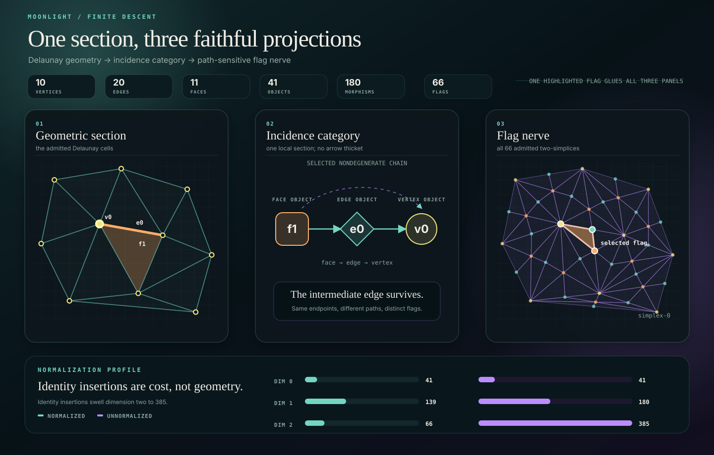

# Moonlight category observatory



[Browse all exhibits.](../README.md)
· [Read the package operation index.](../../README.md#operations)

The category observatory follows one checked finite section through three
synchronized views: the selected Delaunay cells, their incidence category, and
the normalized nerve of that category. The visual above is the package-owned
compact SVG projection of the same admitted `Exhibit`: one face-edge-vertex
flag is restricted through all three panels while the full mesh and 66
two-simplices remain visible. It is neither a viewport screenshot nor a second
mathematical model.

## Cell-complex and category interpretation

The `cell-complex` component interprets an `ExactCellSet` as Homology's generic
`CellComplex2D`. The opaque carrier retains the authoritative selected handles
and resident DCEL. `fromExactCellSet` is total because `ExactCellSet`
construction has already discharged downward closure and handle validity.

The interpretation is available on GHC 9.14 and newer. Existing Triangulation
components retain the package's GHC 9.8–9.14 support range: below 9.14 Cabal
marks only `cell-complex`, its focused test, and the category-observatory
exporter unbuildable. Hackage aggregates dependencies from every component on
the package page, but an ordinary main-library consumer does not inherit the
Homology or Category closure.

```cabal
-- the consumer package
build-depends:
  base >= 4.22 && < 5,
  moonlight-triangulation >= 1.4 && < 1.5,
  moonlight-planar:cell-complex >= 1.0 && < 1.1,
  moonlight-homology:cell-category >= 0.1 && < 0.2
```

```haskell
import Moonlight.Homology.Pure.Topology.CellCategory (complexCategory)
import Moonlight.Triangulation.CellComplex (fromExactCellSet)

incidenceCategory = complexCategory . fromExactCellSet
```

## What owns what

The executable composes existing owners in one direction:

```text
ExactCellSet
  -> Moonlight.Triangulation.CellComplex.DCELComplex
  -> Moonlight.Homology.Pure.Topology.CellCategory.ComplexCat
  -> Moonlight.Category.Simplicial.normalizedNerve
  -> checked schema-version-2 JSON
  -> Melusine's /category browser projection
```

`moonlight-triangulation-category-observatory-export` owns only the checked
projection boundary. Geometry remains in Triangulation, the generic
two-dimensional cell interface and incidence category remain in Homology, and
the browser remains a derived view. There is no observatory-specific mesh,
category implementation, or nerve implementation lurking behind the scenery.

## Deterministic witness

The retained ten-point section yields:

| observation | count |
| --- | ---: |
| vertices | 10 |
| undirected edges | 20 |
| bounded faces | 11 |
| category objects | 41 |
| category morphisms | 180 |
| face-edge-vertex incidence flags | 66 |

The normalized and identity-saturated unnormalized nerves contain respectively
`41 / 41`, `139 / 180`, and `66 / 385` simplices in dimensions 0, 1, and 2.
Each rendered 2-simplex retains its intermediate edge; this is the
path-sensitive incidence flag nerve, not a thinned face poset.

Before encoding, the pure builder checks the selected-cell inventory, the four
morphism classes, every morphism endpoint, every 2-simplex shape, and equality
between the face-incidence and rendered-flag counts. Failures inhabit
`ExhibitError`; stdout receives JSON only after those local sections glue.

## Run the exporter

The Homology-backed component requires GHC 9.14 or newer. From the repository
root:

```console
scripts/safe-cabal.sh run \
  moonlight-planar:exe:moonlight-triangulation-category-observatory-export \
  --project-file=cabal.project.planar-dev
```

That command emits the deterministic schema-version-2 document to stdout. To
regenerate or verify the retained documentation picture:

```console
scripts/safe-cabal.sh run \
  moonlight-planar:exe:moonlight-triangulation-category-observatory-export \
  --project-file=cabal.project.planar-dev -- \
  picture compiler/foundation/moonlight-planar/docs/category-observatory/moonlight-triangulation-category-observatory.svg
scripts/safe-cabal.sh run \
  moonlight-planar:exe:moonlight-triangulation-category-observatory-export \
  --project-file=cabal.project.planar-dev -- \
  verify-artifacts compiler/foundation/moonlight-planar
```

To run the interactive browser consumer:

```console
cd compiler/engine/melusine-visualization
pnpm dev:category
```

Open `http://127.0.0.1:5173/category`. Hovering a cell, category arrow, or flag
restricts the other two panels to the same semantic objects; the dimension
control reveals the normalized 0-, 1-, and 2-simplex sections.

## Source decomposition

`Main.hs` is only the `IO` edge: render a typed obstruction or encode the
admitted exhibit. The pure implementation is split by mathematical
responsibility:

| module | responsibility |
| --- | --- |
| `Moonlight.Triangulation.Exhibit.CategoryObservatory` | deterministic witness and final descent |
| `.Model` | JSON projection types and typed obstructions |
| `.Geometry` | mesh projection and geometric object placement |
| `.Category` | finite object/morphism projection and inventory law |
| `.Nerve` | normalized/unnormalized nerve projection and flag law |
| `.Identifier` | the single identifier/label interpretation shared by all projections |
| `.Picture` | compact pure SVG projection of the admitted exhibit |

The split is semantic rather than ceremonial: no wrapper modules, no duplicate
projection types, no hand-maintained duplicate mesh coordinates, and no mutable
orchestration wearing an expensive hat.
