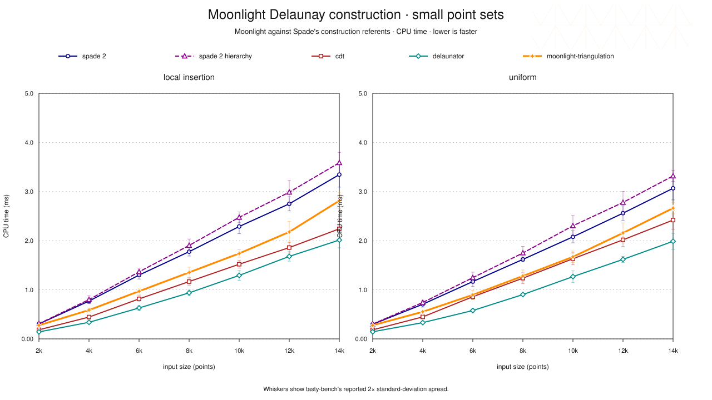

# Moonlight Delaunay Compare

[Browse all exhibits.](../README.md)

`moonlight-triangulation-delaunay-compare` is Moonlight's package-owned port of Spade's
[`delaunay_compare`](https://github.com/Stoeoef/spade/tree/c8befc96bbbc1898a89cb19f9f3104a848936374/delaunay_compare)
construction suite. It retains the upstream case matrix and appends
`moonlight-triangulation` to the implementation list:

1. `spade 2`
2. `spade 2 hierarchy`
3. `cdt`
4. `delaunator`
5. `moonlight-triangulation`

Haskell owns fixture selection, grouping, compatibility descent, timing, and
reporting. The Rust library under `rust/src/lib.rs` is only a typed foreign
boundary to the four Rust implementations and to the exact upstream `rand`
fixture stream; it contains no benchmark policy.

This page owns only the construction slice. The
[operation comparison](../../bench/spade-compare/README.md) owns the broader
Moonlight–Spade board.

## Pictures

Both pictures are derived from the single retained board.




These retain Spade's plain GNUPLOT idiom: white field, Helvetica, dashed grey
grid, jewel-coloured point series, and the same small/big split. Moonlight is
the heavier orange star. The faint triangulation mesh is the sole bit of
levity; benchmark charts need not resemble tax forms.

## Result

- timed cases: `120`
- fixture summaries agreeing across all five implementations: `24 / 24`
- Moonlight mean below plain Spade: `24 / 24`
- Moonlight mean below Spade hierarchy: `24 / 24`
- Moonlight below plain Spade with non-overlapping reported 2σ: `18 / 24`
- Moonlight below Spade hierarchy with non-overlapping reported 2σ: `22 / 24`
- lowest fixture mean: `delaunator` `21 / 24`; `cdt` `3 / 24`
- median reported 2σ / mean: Moonlight `6.88%`; plain Spade `6.67%`

Selected means are in milliseconds. Δ is
`100 × (Moonlight / competitor − 1)`.

| fixture | points | Moonlight | plain Spade | Δ | Spade hierarchy | Δ |
|---|---:|---:|---:|---:|---:|---:|
| local insertion | 4,000 | 0.587 | 0.771 | −23.8% | 0.800 | −26.6% |
| local insertion | 6,000 | 0.971 | 1.300 | −25.3% | 1.365 | −28.9% |
| local insertion | 8,000 | 1.354 | 1.776 | −23.7% | 1.903 | −28.8% |
| local insertion | 250,000 | 60.300 | 72.713 | −17.1% | 77.496 | −22.2% |
| uniform | 4,000 | 0.552 | 0.706 | −21.8% | 0.741 | −25.6% |
| uniform | 14,000 | 2.663 | 3.067 | −13.2% | 3.318 | −19.7% |
| uniform | 250,000 | 60.028 | 72.783 | −17.5% | 77.435 | −22.5% |

The measured Moonlight path is the canonical circle-sweep bulk loader. Its
geometry ingress keeps coordinates in immutable planes, moves only a 32-bit
vertex-id plane through three radix passes, and restores the complete
`(distance, x, y, vertex)` order inside equal-prefix fibres before descent.
Fresh dense vertices are committed once, and the sweep consumes reserved cells
without constructing a second packed geometry arena.

Receipt identity:

- command completed: `2026-08-23T00:00:15Z`, 318.68 s over 120 cases
- host: Apple M4 Pro, arm64, macOS 26.5.2, GHC 9.14.1, rustc 1.92.0
- Haskell build: cabal-install 3.16.1.0, focused `-O1` package profile,
  comparison executable `-O2`, hot predicate, sweep, and repair modules LLVM
  `-O3`
- checkout base HEAD: `41906f44f0`, plus the three optimized runtime-source
  owners named by the manifest
- CSV: [`moonlight-delaunay-compare-2026-08-22.csv`](results/moonlight-delaunay-compare-2026-08-22.csv), SHA-256
  `cce6af4ac7d570970a69124f5648db4e13ca41e91e05383306407a0dca323be7`
- benchmark runtime-source hashes:
  [`moonlight-delaunay-compare-2026-08-22.source-sha256`](results/moonlight-delaunay-compare-2026-08-22.source-sha256), SHA-256
  `069d3bb1639b6d865fe4491b2fbbb9d0cdc8324173e30bebf690ed6592190c20`

The Haskell projection in
`Moonlight.Triangulation.Bench.DelaunayCompare.Picture` parses the tasty-bench
CSV against the exact closed 120-case registry and reports typed obstructions
for malformed, unknown, duplicated, or missing observations before gluing
either picture.

## Run

From the repository root, list the complete benchmark tree:

```console
scripts/safe-cabal.sh run \
  moonlight-planar:exe:moonlight-triangulation-delaunay-compare \
  --project-file=cabal.project.planar-dev \
  -- --list-tests
```

Run the comparison on one uncontended thread with wall-clock timing:

```console
scripts/safe-cabal.sh run \
  moonlight-planar:exe:moonlight-triangulation-delaunay-compare \
  --project-file=cabal.project.planar-dev \
  -- --time-mode wall -j1
```

The Haskell executable builds the pinned Rust library through Cargo before it
loads the library. Cargo's incremental no-op is cheap after the first run. Set
`MOONLIGHT_DELAUNAY_COMPARE_RUST_MANIFEST` only when invoking an installed executable
outside this repository layout.

## Reproduce a board

Every candidate run uses one CPU-time worker, a 30-second per-case timeout, and
tasty-bench's `--stdev 5` calibration target. Name the candidate by the date it
completed; after validation, it replaces the retained CSV and source manifest
rather than accumulating a benchmark diary.

```console
caffeinate -i scripts/safe-cabal.sh run \
  moonlight-planar:exe:moonlight-triangulation-delaunay-compare \
  --project-file=cabal.project.planar-dev -- \
  --stdev 5 --timeout 30s --time-mode cpu -j1 \
  --csv foundation/moonlight-planar/docs/delaunay-compare/results/moonlight-delaunay-compare-YYYY-MM-DD.csv \
  --color never --hide-progress --min-duration-to-report 1h
```

Both pictures are then regenerated from the candidate CSV, which is the only
CSV they may be derived from:

```console
scripts/safe-cabal.sh run \
  moonlight-planar:exe:moonlight-triangulation-delaunay-pictures \
  --project-file=cabal.project.planar-dev -- \
  foundation/moonlight-planar/docs/delaunay-compare/results/moonlight-delaunay-compare-YYYY-MM-DD.csv \
  foundation/moonlight-planar/docs/delaunay-compare/results
```

The runtime-source manifest beside the CSV is regenerated from the measured
worktree immediately after a completed command. It hashes the closed list of
files that entered timed actions; picture sources and package-only metadata are
excluded because they did not. The receipt, CSV, and big SVG stay
benchmark-owned beside the executable and outside Cabal package inputs. The
small SVG is also the package documentation projection, so it enters the sdist
without entering any compiled component.

## Upstream-compatible fixtures

Both distributions use the 32-byte `StdRng` seed from upstream, including its
embedded newline byte. Rust unit tests pin the first three points of both
streams by their exact binary64 bit patterns.

- `local insertion` starts at `(0, 1)` and adds independent inclusive steps
  from `[-1, 1]`.
- `uniform` draws each coordinate independently and inclusively from
  `[-1e9, 1e9]`.
- `small` contains 2,000 through 14,000 points in increments of 2,000.
- `big` contains 50,000 through 250,000 points in increments of 50,000.

Native input conversion happens once during suite preparation, outside every
timed action, exactly as upstream's `DelaunayCrate.init` separates conversion
from `run_creation`. Spade still clones its owned vertex vector inside each
construction call because that is what its bulk-load API and upstream adapter
require; `cdt`, `delaunator`, and Moonlight consume their prepared vectors by
reference.

## Compatibility gate

Before `tasty-bench` runs, every one of the 24 fixtures descends across all five
implementations. The sections glue only when vertex and inner-triangle counts
agree. A generator, preparation, construction, foreign-boundary, or summary
failure is a typed obstruction and terminates the command before timing.

This count gate is deliberately not a second topology authority. The broader
operation comparison owns canonical-edge and operation agreement. This command
answers the narrower upstream question: bulk construction time over the
upstream point distributions and sizes.

The upstream `examples/real_data_benchmark.rs` CDT/shapefile program is a
separate executable and is not folded into this creation suite. No 45 MB dataset
or network fetch is concealed in benchmark startup.

## Harness difference

Upstream uses Rust Criterion. This port uses Haskell `tasty-bench`, so it does
not pretend Criterion's warm-up seconds or sample-count knobs map one-to-one to
another calibrator. The inputs, sizes, implementation calls, and timed/setup
boundary are preserved; calibration and reporting are honestly Haskell.
