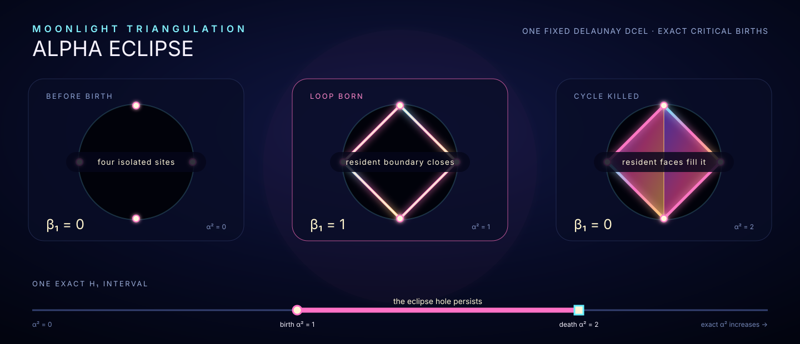

# Moonlight alpha eclipse



[Open the full-size vector.](./moonlight-triangulation-alpha-eclipse.svg)
· [Browse all exhibits.](../README.md)
· [Read the exact-filtration API semantics.](./README.md#exact-alpha-filtration-and-persistent-topology)

The eclipse uses the package's canonical four-site square witness and isolates
its one finite `H₁` interval. The four sites, five resident Delaunay edges, and
two resident faces remain fixed: the four hull edges close one hole at exact
`α² = 1`; the resident diagonal and both resident faces enter at exact
`α² = 2`, making that cycle a boundary. Only the alpha sublevel changes. Every
visible cell is projected from the resident DCEL, and the `β₁ = 0 → 1 → 0`
profile comes from Moonlight Homology rather than a hand-authored diagram.

## Reproduce

On GHC 9.14, the package-owned generator reproduces the retained vector:

```console
cabal run moonlight-planar-persistence-rose -- eclipse alpha-eclipse.svg
```
